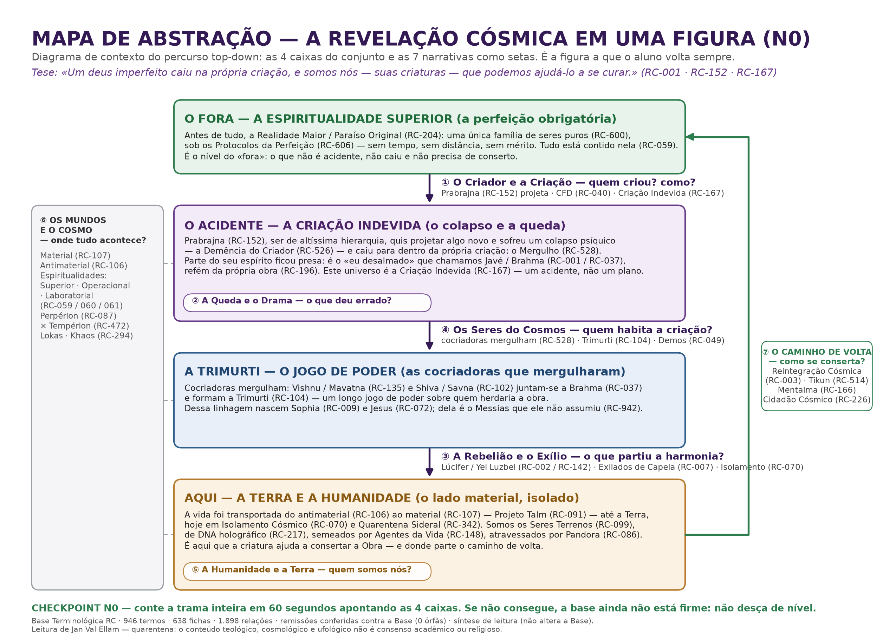

@titulo: O Mapa de Abstração — a Revelação Cósmica em uma Figura (N0)
@autor: Apostila de Estudo — Base Terminológica RC (fase top-down)
@data: 2026-09-07
@local: pedagogico/top-down — material N0, a figura fixa do percurso top-down
@subtitulo: Materialização da melhoria pedagógica nº 1 da proposta top-down: o diagrama de contexto com as 4 caixas (FORA · ACIDENTE · TRIMURTI · AQUI) e as 7 narrativas como setas. Síntese de leitura sobre a Base Terminológica RC (946 termos · 1.898 relações) — não altera a Base.
@nota_editor: Esta apostila é o material N0 da fase top-down: a "figura fixa" a que o aluno volta em todos os níveis. Não é mais uma apostila temática — é o diagrama de contexto do método top-down (Analista de Sistemas): uma tela só, com o sistema inteiro, suas entradas e suas saídas. Todo o conteúdo é síntese de leitura da Base atual (946 termos · 638 fichas · 1.898 relações), reorganizado a partir da PROPOSTA-PEDAGOGICA-TOP-DOWN.md (N0, N1 e §8) e das 10 apostilas já publicadas nesta pasta. Nenhuma alteração foi feita em termos/, relacoes/ ou ferramentas/dados_termos.py. Todas as remissões RC-### foram conferidas contra a Base (0 órfãs). Alegações teológicas, cosmológicas e ufológicas são leitura de Ellam, não consenso acadêmico ou religioso — é a regra de quarentena do acervo. Arquivos irmãos: Mapa-de-Abstracao-N0.svg (vetorial), Mapa-de-Abstracao-N0.pdf (impressão) e Mapa-de-Abstracao-N0.png (esta edição).

# PARTE I — O que é esta figura e onde ela fica no percurso

## A peça que faltava

As 10 apostilas da fase top-down formam o corpo do curso: cada uma aprofunda um tema (a queda, Javé, o lado de fora, o mapa dos mundos, o céu tradicional, a filologia, Thot, o operador humano, carbono × sílica, os tratados). O que ainda não existia em arquivo era o **primeiro nível** — aquele que vem *antes* de todas elas.

> "O aluno nunca encontra uma informação que ainda não tenha um gancho para pendurar." — regra de ouro da proposta top-down

O Nível 0 é esse gancho. Ele não explica nada em profundidade: ele **mostra a caixa inteira de uma vez**, para que cada detalhe futuro tenha um lugar conhecido onde se encaixar. É exatamente o **diagrama de contexto** da análise de sistemas: você desenha o sistema inteiro numa tela, com suas entradas e saídas, e só depois desce aos subsistemas.

## Onde o N0 se encaixa

| Nível | Pergunta-guia | Onde está materializado |
|---|---|---|
| **N0 — Visão do Conjunto** | O que é isso? | **esta apostila** (a figura fixa) |
| N1 — O Esqueleto | Qual é a trama? | as 7 narrativas (setas desta figura) |
| N2 — As Identidades | Quem é quem? | cadeias canônicas (apostilas 1, 2, 7) |
| N3 — O Enredo no Tempo | O que aconteceu, em que ordem? | apostila 1 (A Queda) |
| N4 — O Detalhe | Como funciona cada peça? | apostilas 3–6, 8–10 + as 638 fichas |

A progressão é **individual → coletivo → filosófico**, como fixado na proposta. O N0 não substitui nada: ele **ordena** o que já existe.

## As três regras de uso desta figura

1. **Volta-se sempre a ela.** Cada vez que o aluno desce um nível, ele retorna ao mapa e percebe que as 4 caixas e as 7 setas *não mudaram* — só ganharam espessura.
2. **Só se desce com a base firme.** O checkpoint do N0 é narrar a trama em 60 segundos apontando as 4 caixas. Se não consegue, não passa de nível.
3. **A figura não é o território.** Ela é um mapa de leitura da RC, não uma prova e não um catecismo (ver PARTE VII).

# PARTE II — A figura (o diagrama de contexto)



*Figura 1 — Mapa de Abstração (N0). Leitura: desce-se pela coluna central (FORA → ACIDENTE → TRIMURTI → AQUI) e sobe-se pelo canal da direita (o caminho de volta). A banda da esquerda é o substrato: os mundos e o cosmo onde tudo acontece. Arquivos: `.svg` (vetorial), `.pdf` (impressão), `.png` (esta edição).*

## A tese em uma frase

> "Um deus imperfeito caiu na própria criação, e somos nós — suas criaturas — que podemos ajudá-lo a se curar." (RC-001 · RC-152 · RC-167)

## A trama em 60 segundos (o checkpoint)

Existe um **fora** perfeito (a Espiritualidade Superior, RC-059). Um ser de altíssima hierarquia, **Prabrajna** (RC-152), quis projetar algo novo, sofreu um colapso psíquico e **caiu para dentro da própria criação** (o Mergulho, RC-528), deixando parte do seu espírito refém — é o "eu desalmado" que chamamos **Javé / Brahma** (RC-001 / RC-037). Outras divindades **mergulharam** para tentar resolver, formando a **Trimurti** (RC-104) e um longo **jogo de poder** sobre quem herdaria a obra; dessa linhagem nascem **Sophia** (RC-009) e **Jesus** (RC-072). A vida foi **transportada** do lado antimaterial (RC-106) para o material (RC-107) e os acontecimentos desceram até a **Terra**, hoje isolada (RC-070). Por fim, as **criaturas** — nós — ajudam a **consertar** a Obra (Tikun, RC-514) rumo à **Reintegração Cósmica** (RC-003).

Se o aluno consegue repetir isso apontando as 4 caixas, o N0 está cumprido.

# PARTE III — As quatro caixas, uma a uma

## O FORA — a Espiritualidade Superior (a perfeição obrigatória)

Antes de tudo existe a **Realidade Maior / Paraíso Original** (RC-204): uma única família de seres puros, os **Seres Originais do Paraíso** (RC-600), vivendo sob os **Protocolos / Algoritmos da Perfeição** (RC-606) — sem tempo, sem distância, sem mérito. Tudo está contido nela (RC-059).

O detalhe que destrava o resto do curso: a perfeição era vivida como **protocolo**, não como **liberdade**. A crise não começa por maldade, e sim por uma indagação interna à própria perfeição — a "pergunta cretina" que move toda a sequência (RC-606 · RC-526). É o nível do *fora*: o que não é acidente, não caiu e não precisa de conserto.

## O ACIDENTE — a Criação Indevida (o colapso e a queda)

**Prabrajna** (RC-152), ser de altíssima hierarquia, quis projetar algo novo e sofreu um **colapso psíquico** — a **Demência do Criador** (RC-526) — caindo para dentro da própria criação: o **Mergulho** (RC-528). Parte do seu espírito ficou presa: é o "eu desalmado" que chamamos **Javé / Brahma** (RC-001 / RC-037), **refém da própria obra** (RC-196).

Este universo é a **Criação Indevida** (RC-167) — um acidente, não um plano. É a caixa que responde à pergunta "o que deu errado?", e é dentro dela que se dá o autoencontro do criador com a própria criação (narrativa ②, marcada como pílula dentro da caixa na figura).

## A TRIMURTI — o jogo de poder (as cocriadoras que mergulharam)

Divindades cocriadoras mergulharam na experiência: **Vishnu / Mavatna** (RC-135) e **Shiva / Savna** (RC-102) juntam-se a **Brahma** (RC-037) e formam a **Trimurti** (RC-104) — um longo jogo de poder sobre quem herdaria a obra. Dessa linhagem nascem **Sophia** (RC-009) e **Jesus** (RC-072); dela é também o **Messias** violento que ele não assumiu (RC-942).

> Dica pedagógica (melhoria nº 11 da proposta): não apresente a Trimurti como um dado — apresente-a como **conflito**. Conflito é o que segura a atenção.

## AQUI — a Terra e a humanidade (o lado material, isolado)

A vida foi transportada do **antimaterial** (RC-106) para o **material** (RC-107) — **Projeto Talm** (RC-091) — e os acontecimentos desceram até a Terra, hoje em **Isolamento Cósmico** (RC-070) e **Quarentena Sideral** (RC-342). Somos os **Seres Terrenos** (RC-099), de **DNA como projeção holográfica** (RC-217), semeados por **Agentes da Vida** (RC-148) e atravessados por **Pandora** (RC-086).

É aqui que a criatura ajuda a consertar a Obra — e é daqui que parte o caminho de volta.

# PARTE IV — As sete narrativas como setas (o esqueleto)

As 7 narrativas do Guia-Mestre são o **esqueleto** da figura: elas não são capítulos, são as **setas** que ligam as caixas. Cada uma tem uma pergunta-guia.

| # | Narrativa (seta) | Pergunta-guia | Onde a seta passa na figura | Âncora |
|---|---|---|---|---|
| ① | O Criador e a Criação | Quem criou? Como? | FORA → ACIDENTE | RC-152 · RC-040 · RC-167 |
| ② | A Queda e o Drama | O que deu errado? | dentro do ACIDENTE (o criador cai *para dentro*) | RC-526 · RC-528 · RC-196 |
| ③ | A Rebelião e o Exílio | O que partiu a harmonia? | TRIMURTI → AQUI | RC-002 · RC-007 · RC-342 · RC-070 |
| ④ | Os Seres do Cosmos | Quem habita a criação? | ACIDENTE → TRIMURTI (as cocriadoras mergulham) | RC-104 · RC-049 · RC-024 · RC-036 |
| ⑤ | A Humanidade e a Terra | Quem somos nós? | dentro de AQUI | RC-099 · RC-217 · RC-148 · RC-086 |
| ⑥ | Os Mundos e o Cosmo | Onde tudo acontece? | a banda da esquerda — o substrato de tudo | RC-107 · RC-106 · RC-059/060/061 · RC-087 × RC-472 |
| ⑦ | O Caminho de Volta | Como se conserta? | AQUI → FORA (o laço que fecha o diagrama) | RC-003 · RC-514 · RC-166 · RC-226 |

## O laço, não a lista

O ponto mais importante da figura é que **⑦ fecha o diagrama**: a saída de AQUI volta para o FORA. Não é uma lista linear de eventos — é um **laço de causa e efeito** em que a criatura (AQUI) é o agente que falta para o sistema se fechar (Reintegração Cósmica, RC-003 · Tikun, RC-514). Por isso a seta de retorno é a única desenhada em outra cor.

## Reforço em espiral

A cada nível, revisitam-se as 7 narrativas. Elas não mudam; só ficam mais grossas:

- **N0:** as 7 setas com uma frase cada.
- **N1:** as 7 setas com a pergunta-guia respondida em um parágrafo.
- **N2:** as 7 setas povoadas de nomes (cadeias canônicas — Javé/Brahma, Sophia/Hochmah RC-565, Lúcifer RC-078 × Satã RC-074).
- **N3:** as 7 setas ordenadas no tempo (marcos, não datas).
- **N4:** cada seta vira uma apostila temática e um conjunto de fichas.

# PARTE V — Como usar o mapa em sala

## Roteiro de uma aula de N0 (sugestão de 60 minutos)

1. **Anamnese (5 min).** Pergunte ao aluno: "o que você acha hoje sobre Deus, a vida e o universo?" — guarde a resposta para comparar no fim do curso (melhoria nº 10 da proposta).
2. **Mostre a figura inteira (5 min).** Sem explicar nada. Deixe o aluno olhar as 4 caixas e as cores.
3. **A tese em uma frase (5 min).** Um deus imperfeito caiu na própria criação; nós podemos ajudá-lo a se curar.
4. **As 4 caixas (20 min).** Uma frase por caixa, na ordem FORA → ACIDENTE → TRIMURTI → AQUI.
5. **As 7 setas (15 min).** Cada seta com a sua pergunta-guia.
6. **Checkpoint (10 min).** O aluno conta a trama em 60 segundos apontando as caixas. Quem não consegue, repete o N0 — não desce.

## Três instrumentos que vêm com a figura

- **Checkpoint de domínio:** "o que você agora consegue explicar?" — no pé da própria figura. Se o aluno não explica, não desce.
- **Glossário progressivo:** não dê 30 termos de uma vez. O N0 entrega **4 a 6 palavras**: Prabrajna, Mergulho, Criação Indevida, Trimurti, Isolamento, Tikun. O resto vem quando a seta aparecer.
- **Metáforas-conector:** preserve as analogias do próprio Ellam (o papagaio de Javé, o big data, a colmeia que colapsa, a "Coca-Cola" de John Lennon). Elas são o gancho de memorização mais poderoso do acervo — não as "domestique".

# PARTE VI — O mapa em texto puro

Para quem imprime sem a figura (ou lê em texto puro), esta é a mesma estrutura em ASCII. A versão vetorial (`Mapa-de-Abstracao-N0.svg`) é a de referência; esta é o plano B.

```
⑥ OS MUNDOS E O COSMO — onde tudo acontece
(Material RC-107 × Antimaterial RC-106 · Espiritualidades RC-059/060/061
 · Perpérion RC-087 × Tempérion RC-472 · Lokas · Khaos RC-294)
     |
     |    +--------------------------------------------------------------+
     |    | O FORA — ESPIRITUALIDADE SUPERIOR (a perfeição obrigatória)   |
     +--->| Realidade Maior (RC-204) · Seres Originais (RC-600)           |
          | Protocolos da Perfeição (RC-606) — sem tempo, sem mérito      |
          +--------------------------------------------------------------+
                                    |
                        ① O Criador e a Criação — QUEM CRIOU? COMO?
                        Prabrajna (RC-152) · CFD (RC-040)
                                    |
                                    v
          +--------------------------------------------------------------+
          | O ACIDENTE — A CRIAÇÃO INDEVIDA (o colapso e a queda)         |
          | Prabrajna projeta, colapsa (RC-526) e cai para dentro (RC-528)|
          | Javé / Brahma (RC-001 / RC-037), refém da obra (RC-196)       |
          | [② A Queda e o Drama — O QUE DEU ERRADO?]                     |
          +--------------------------------------------------------------+
                                    |
                    ④ Os Seres do Cosmos — QUEM HABITA A CRIAÇÃO?
                    cocriadoras mergulham · Trimurti (RC-104) · Demos (RC-049)
                                    |
                                    v
          +--------------------------------------------------------------+
          | A TRIMURTI — O JOGO DE PODER (as cocriadoras que mergulharam) |
          | Brahma (RC-037) · Vishnu (RC-135) · Shiva (RC-102)            |
          | Sophia (RC-009) · Jesus (RC-072) · Messias (RC-942)           |
          +--------------------------------------------------------------+
                                    |
              ③ A Rebelião e o Exílio — O QUE PARTIU A HARMONIA?
              Lúcifer / Yel Luzbel (RC-002 / RC-142) · Exilados de Capela
              (RC-007) · Quarentena (RC-342) · Isolamento (RC-070)
                                    |
                                    v
          +--------------------------------------------------------------+
          | AQUI — A TERRA E A HUMANIDADE (o lado material, isolado)      |
          | antimaterial (RC-106) -> material (RC-107) · Projeto Talm      |
          | (RC-091) · Seres Terrenos (RC-099) · DNA holográfico (RC-217)  |
          | [⑤ A Humanidade e a Terra — QUEM SOMOS NÓS?]                  |
          +--------------------------------------------------------------+
                                    |
                                    |  ⑦ O CAMINHO DE VOLTA — COMO SE CONSERTA?
                                    |  Reintegração (RC-003) · Tikun (RC-514)
                                    |  Mentalma (RC-166) · Cidadão Cósmico (RC-226)
                                    +---------------------------+
                                                                |
                                       volta ao FORA <-----------+

CHECKPOINT N0: conte a trama em 60 segundos apontando as 4 caixas.
Se não consegue, a base ainda não está firme: não desça de nível.
```

# PARTE VII — O mapa não é o território

## Quarentena rotulada desde o início

Toda a RC é **leitura de Jan Val Ellam** sobre teologia, cosmologia, ufologia e clínica. Isso **não é consenso acadêmico nem religioso**, e o aluno precisa aprender essa distinção no primeiro dia — não no décimo. É a regra de quarentena do acervo (melhoria nº 8 da proposta).

## Mapa × território

A Bíblia e as mitologias falam de um **mapa**; a RC pretende falar do **território**. O aluno não deve usar as categorias religiosas como chave de leitura — a apostila 5 (Céu Tradicional × Paraíso das RC) é a que destrava essa comparação.

## O que esta figura deliberadamente não faz

- **Não substitui as fontes.** Cada caixa remete a fichas RC-###; a figura é o índice, não o conteúdo.
- **Não resolve as tensões.** Onde a Base registra divergência (datas relativas/interdimensionais, identidades que se confundem), a figura preserva a incerteza — ver o caderno abaixo.
- **Não esgota o N1.** As 7 narrativas aparecem aqui como setas e perguntas-guia; o desenvolvimento de cada uma é o nível seguinte.

## GLOSSÁRIO DO MAPA

## A — As 4 caixas

- **O FORA** — a Espiritualidade Superior; a perfeição obrigatória, anterior a tudo [RC-059 · RC-204 · RC-600]
- **O ACIDENTE** — a Criação Indevida: o colapso de Prabrajna e a queda para dentro da obra [RC-167 · RC-152 · RC-528]
- **A TRIMURTI** — Brahma · Vishnu · Shiva: as cocriadoras que mergulharam e o jogo de poder [RC-104 · RC-037 · RC-135 · RC-102]
- **AQUI** — o lado material e isolado: a Terra, a humanidade e o ponto de partida da volta [RC-107 · RC-070 · RC-099]

## B — As 7 narrativas (as setas)

- **① O Criador e a Criação** — quem criou? como? Prabrajna projeta [RC-152 · RC-040 · RC-167]
- **② A Queda e o Drama** — o que deu errado? a demência e o mergulho [RC-526 · RC-528 · RC-196]
- **③ A Rebelião e o Exílio** — o que partiu a harmonia? Lúcifer, Capela, quarentena [RC-002 · RC-142 · RC-007 · RC-342]
- **④ Os Seres do Cosmos** — quem habita a criação? Trimurti, demos, anunnakis, biodemos [RC-104 · RC-049 · RC-024 · RC-036]
- **⑤ A Humanidade e a Terra** — quem somos nós? seres terrenos, DNA holográfico, Pandora [RC-099 · RC-217 · RC-086]
- **⑥ Os Mundos e o Cosmo** — onde tudo acontece? material × antimaterial, espiritualidades [RC-107 · RC-106 · RC-059]
- **⑦ O Caminho de Volta** — como se conserta? reintegração, Tikun, Mentalma [RC-003 · RC-514 · RC-166]

## C — Conceitos do diagrama

- **Diagrama de contexto** — a figura única de uma tela com o sistema inteiro; primeira peça do método top-down [metodologia]
- **Decomposição sucessiva** — descer de nível só quando o anterior está firme [metodologia]
- **Checkpoint de domínio** — "o que você agora consegue explicar?"; a régua do avanço [metodologia]
- **Reforço em espiral** — revisitar as 7 narrativas a cada nível; elas engrossam, não mudam [metodologia]
- **Glossário progressivo** — 4 a 6 termos por módulo, não 30 de uma vez [metodologia]
- **Quarentena** — selo de "leitura de Ellam", distinto de consenso acadêmico/religioso [metodologia]
- **Pergunta-guia** — cada seta abre com uma pergunta e fecha com ela respondida (método socrático) [metodologia]

## D — Termos próprios da RC citados nesta figura

- **Prabrajna** — o ser de altíssima hierarquia que projetou, colapsou e caiu [RC-152]
- **Mergulho** — a designação ellâmica da queda para dentro da própria criação [RC-528]
- **Demência do Criador** — a condição do criador: doença, não atraso evolutivo [RC-526]
- **Criador refém** — o criador prisioneiro da própria obra [RC-196]
- **Criação Indevida** — este universo como acidente, não como plano [RC-167]
- **Isolamento Cósmico** — a Terra apartada do circuito; quarentena sideral [RC-070 · RC-342]
- **Projeto Talm** — o transporte da vida do antimaterial ao material [RC-091]
- **DNA holográfico** — o DNA como projeção do psiquismo do criador [RC-217]
- **Reintegração Cósmica** — a volta da Terra ao circuito; o fechamento do laço [RC-003]
- **Tikun Cósmico** — o conserto da Obra pelas criaturas [RC-514]
- **Mentalma** — o instrumental mental do operador humano no caminho de volta [RC-166]
- **Cidadão Cósmico** — a condição final do ser reintegrado [RC-226]
- **Messias** — o papel violento que Jesus não assumiu [RC-942]

## CADERNO DE INCERTEZAS

- **Datas:** a figura não traz datas. A cronologia da RC usa marcos, não decoreba — muitas datas são relativas ou interdimensionais e forçá-las gera erro (ver apostila 1, A Queda).
- **A identidade Javé / Brahma:** a Base trata Javé (RC-001) e Brahma (RC-037) como o mesmo ser em culturas diferentes; a figura os apresenta juntos na caixa do ACIDENTE, sem decidir a primazia do nome.
- **Sophia e Jesus como "linhagem":** a filiação de Sophia (RC-009) e Jesus (RC-072) à linhagem de Vishnu/Mavatna é leitura de Ellam consolidada em F044 e em P2020-04-04 — não é consenso cristão nem acadêmico.
- **A seta ④ (Seres do Cosmos):** foi desenhada entre ACIDENTE e TRIMURTI porque é ali que as cocriadoras mergulham; a população da criação (demos RC-049, anunnakis RC-024, biodemos RC-036) atravessa todas as caixas, não só essa seta.
- **A seta ③ (Rebelião e Exílio):** a rebelião de Lúcifer (RC-002) e o exílio de Capela (RC-007) são eventos do cosmo; foram desenhados descendo para AQUI porque é ali que o seu efeito se consuma (Isolamento RC-070 · Quarentena RC-342).
- **O colapso da Trimurti:** a desconstituição da Trimurti (RC-104) é marco recente na leitura de Ellam; a figura preserva a caixa inteira porque o N0 descreve a estrutura, não o estado corrente.
- **Nada aqui altera a Base:** a figura e esta apostila são síntese de leitura — `termos/`, `relacoes/` e `ferramentas/dados_termos.py` seguem intactos (946 termos · 638 fichas · 1.898 relações · 102 obras).

FIM
